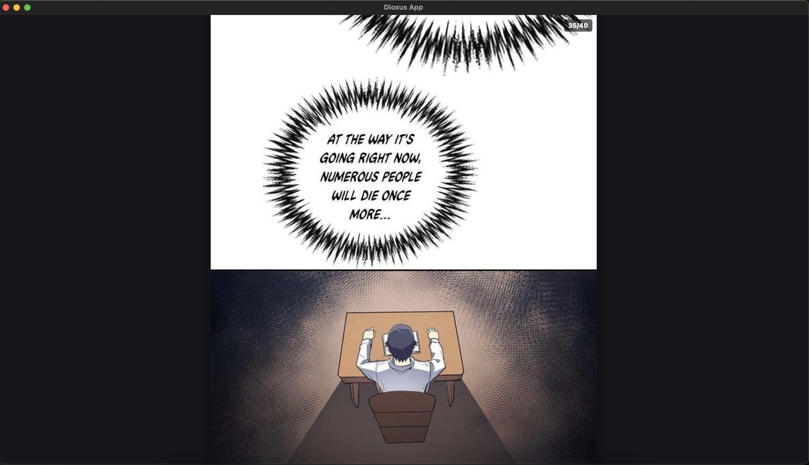

# Manga4Deck

A manga, manhwa, and PDF reader for Steam Deck and self-hosted Kavita servers, built with Rust and Dioxus.

- Library and chapter shelves
- Scrolling reader with a page slider
- Offline reading and progress sync

## Getting started

Install Rust and Cargo, plus the native UI dependencies on Linux.

From the repository root:

```bash
cargo run --manifest-path src/Cargo.toml
```

Open **Settings**, enter your Kavita address as `host:port` (for example, `192.168.1.100:5000`), your credentials and API key, then select **Save**. Connections currently use HTTP.

Leave the password or API key blank to keep its saved value.

## Controls

Map Steam Deck buttons to these keys:

| Action | Key |
| --- | --- |
| Activate selected tile | Enter or Space |
| Go back | Backspace |
| Move shelf selection | Arrow keys |
| Scroll reader | Up / Down |
| Show or move page slider | Left / Right |
| Toggle chapter or volume as read/unread (online) | F1 |
| Manage series downloads | F2 |

The first Left or Right press opens the slider; subsequent presses change the page. You can also tap the page counter and drag the slider. It hides after five seconds of inactivity.

F2 starts a series download, stops an active download, or removes a fully cached series. It works from the series shelf, volume shelf, and reader.

## Offline reading

Download a series before disconnecting, then switch the dashboard's Online/Offline tile to offline. Downloads skip completed chapters. Offline browsing shows series whose remaining unread chapters are fully cached.

Progress follows the visible page, and reopening a chapter resumes there. Updates are saved locally before upload; failed uploads are retried on the next page update or reconnect.

PDF reading requires Kavita's rendered PDF image support (`extractPdf=true`). The first page may take longer to render. Multi-chapter volumes appear as separate chapter entries.

On Steam Deck/Linux, settings and cached pages are stored in `~/.local/share/manga4deck-cache/`.

## Build

```bash
cargo check --manifest-path src/Cargo.toml --locked
cargo build --manifest-path src/Cargo.toml --release --locked
```

The app uses authenticated local services on `127.0.0.1:11337` (HTTP) and `127.0.0.1:11338` (WebSocket).

## Screenshots





## Features

- Steam Deck friendly shelf UI
- Kavita library, series, volume, and page browsing
- Offline/cache-aware volume and series state
- Cover thumbnails cached as small JPEGs for faster shelf loading
- Reader with batch page loading
- PDF books displayed as page images in the same scrolling reader, with progress and offline caching
- Keyboard and Steam Deck controller friendly navigation

## Controls

Recommended Steam Deck keyboard mappings:

| Action | Key |
| --- | --- |
| Activate selected tile | Enter |
| Go back | Backspace |
| Move selection on shelves | Arrow keys |
| Scroll reader | Up / Down |
| Show and move reader page slider | Left / Right |

Reader behavior:

- Up and Down scroll the page.
- First Left or Right press shows the page slider.
- While the slider is visible, Left and Right change the selected page.
- The slider hides 5 seconds after the last Left or Right press.

## Development

### Requirements

- Rust and Cargo
- Node.js LTS and npm
- Linux packages required by the native UI stack, for example on Ubuntu:

```bash
sudo apt-get update
sudo apt-get install -y \
  build-essential \
  libayatana-appindicator3-dev \
  librsvg2-dev \
  libssl-dev \
  libwebkit2gtk-4.1-dev \
  libxdo-dev \
  patchelf \
  pkg-config
```

### Install dependencies

```bash
npm ci
```

### Run Manga4Deck

```bash
npm run manga4deck
```

This starts the Rust backend HTTP API and launches the native Manga4Deck UI.

### Build/check

Check the Manga4Deck build:

```bash
cargo check --manifest-path src/Cargo.toml
```

Build the Manga4Deck binary:

```bash
cargo build --manifest-path src/Cargo.toml
```

## Kavita

Manga4Deck expects access to a Kavita server. Server IP, username/password, and API key are stored by the app settings UI.

PDF pages are rendered by Kavita using its reader image API (`extractPdf=true`) and cached locally like manga pages. Your Kavita version must support this option. The first page can take longer while the server renders the book. No local PDF renderer is needed. Cache a series before disconnecting to read its PDF pages offline.

The local backend listens on:

```text
0.0.0.0:11337
```
