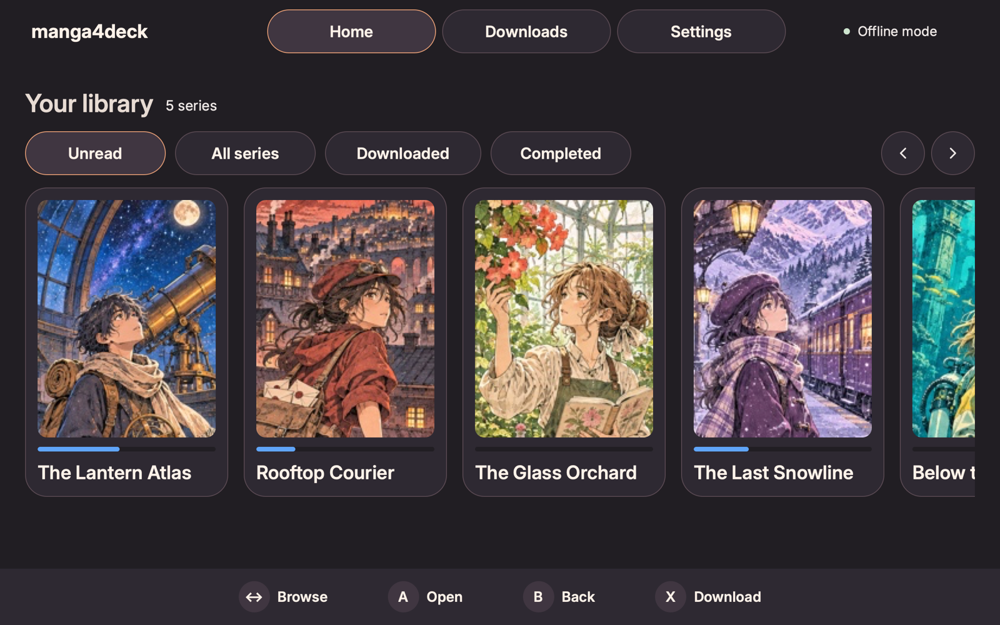
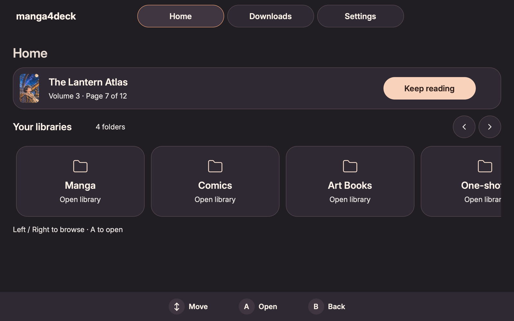
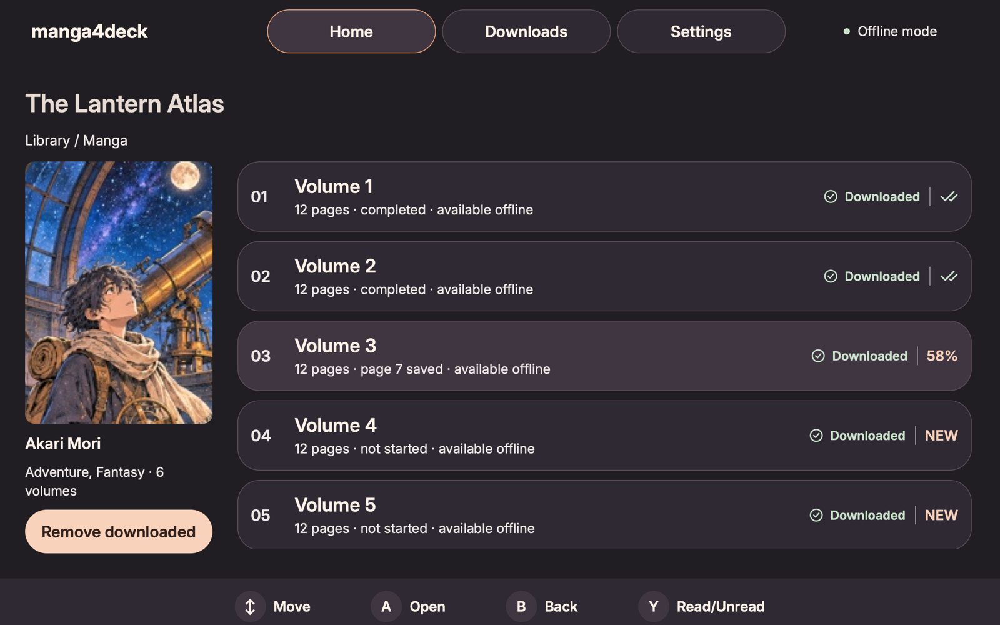
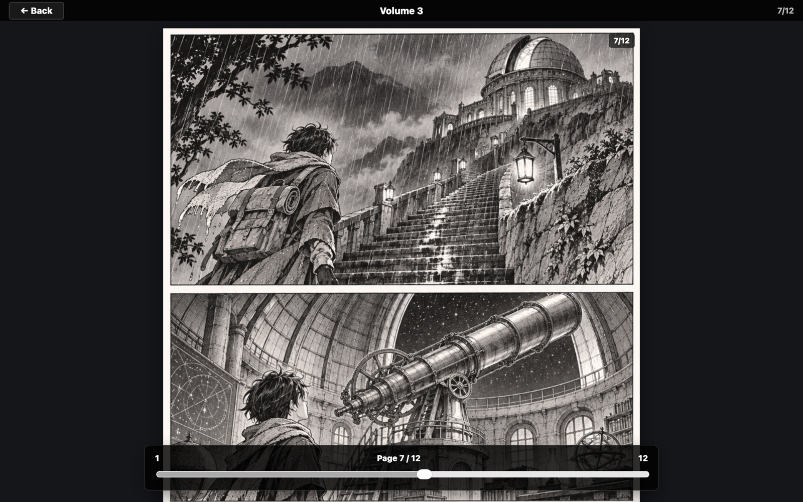

<p align="center">
  
</p>

# Manga4Deck

[](https://github.com/boddicheg/manga4deck/releases)
[](https://github.com/boddicheg/manga4deck/actions/workflows/main.yml)
[](https://github.com/boddicheg/manga4deck/stargazers)
[](LICENSE)


Manga4Deck is a native Kavita reader built for Steam Deck. Browse your manga, manhwa, comics, and PDFs with a controller, pick up your last volume from Home, and download unread chapters for offline reading.

## Screenshots

**Library gallery**



| Home | Series detail |
| --- | --- |
|  |  |

<details>
<summary>Reader screenshot</summary>



</details>

## Usage

### Connect to Kavita

1. Download the x86_64 AppImage from [GitHub Releases](https://github.com/boddicheg/manga4deck/releases). Mark it executable and launch it in Steam Deck Desktop Mode.
2. Open **Settings → Connection**. Enter your Kavita address as `host:port`, your username and password, and your API key.
3. Select **Save & connect**, then open a folder under **Home → Your libraries**.

Manga4Deck connects over HTTP. In **Connection**, leave the password or API key field blank to keep its saved value.

### Browse and read

- Libraries open with **Unread** selected and focus on the first visible title. Switch to **All series**, **Downloaded**, or **Completed** in the filter row. Series with the newest chapter additions appear first, and covers load as they come into view.
- Open a series to pick a volume. Manga4Deck focuses the first unfinished volume and restores your page when you reopen it.
- Use **Settings → Refresh series covers** to refresh cover thumbnails across your Kavita libraries.

| Action | Keyboard | Gamepad |
| --- | --- | --- |
| Move focus | Arrow keys | D-pad or left stick |
| Open a title or apply a filter | Enter or Space | A |
| Go back from a gallery, series detail, or Settings | Backspace or Esc | B |
| Open Downloads from Home or Settings | X | X |
| Manage a focused series download | F2 | X on a library title |
| Mark a focused volume read or unread while online | F1 or Y | Y in the volume list |
| Open Connection from Settings | Y | Y |

In the reader, use Up and Down to scroll and Backspace to return to the volume list. Press Left or Right once to show the page slider, then press again to change pages. You can also click the page counter and drag the slider. The slider hides after five seconds of inactivity. In Steam Input, map the reader controls to these keyboard keys.

### Read offline

Download a series from its detail screen before disconnecting. Downloads skip completed chapters. Open **Downloads** to see saved volumes, or select the **Online** tile in Settings to switch to offline mode. Progress is saved locally and retried when you reconnect.

Kavita renders PDF pages through its reader image API. PDF reading and downloads require server support for `extractPdf=true`.

## Build

Install Rust and Cargo. On Ubuntu, install the native dependencies:

```bash
sudo apt-get update
sudo apt-get install -y \
  build-essential \
  libayatana-appindicator3-dev \
  librsvg2-dev \
  libssl-dev \
  libwebkit2gtk-4.1-dev \
  libxdo-dev \
  patchelf \
  pkg-config
```

From the repository root:

```bash
cargo run --manifest-path src/Cargo.toml --locked
cargo test --manifest-path src/Cargo.toml --locked
cargo build --manifest-path src/Cargo.toml --release --locked
```

The release binary is written to `src/target/release/manga4deck`. For a versioned AppImage release, run **Build and Release Manga4Deck** from the GitHub Actions tab on `main` and enter the release version.

On Linux and Steam Deck, the app stores settings and downloaded pages in `~/.local/share/manga4deck-cache/`. Its authenticated local services use `127.0.0.1:11337` for HTTP and `127.0.0.1:11338` for WebSocket events.

## Credits

- Manga4Deck by [boddicheg](https://github.com/boddicheg) and the [project contributors](https://github.com/boddicheg/manga4deck/graphs/contributors).
- Built with [Rust](https://www.rust-lang.org/) and [Dioxus](https://dioxuslabs.com/) for [Kavita](https://www.kavitareader.com/).
- The screenshots were captured from the native app with a sample library and original demo artwork.

## License

Manga4Deck is licensed under the MIT License. [License text](LICENSE)

The bundled assets have separate license notices. [Inter font](src/assets/Inter-LICENSE.txt) · [Lucide icons](src/assets/Lucide-LICENSE.txt)
